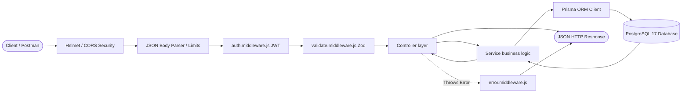
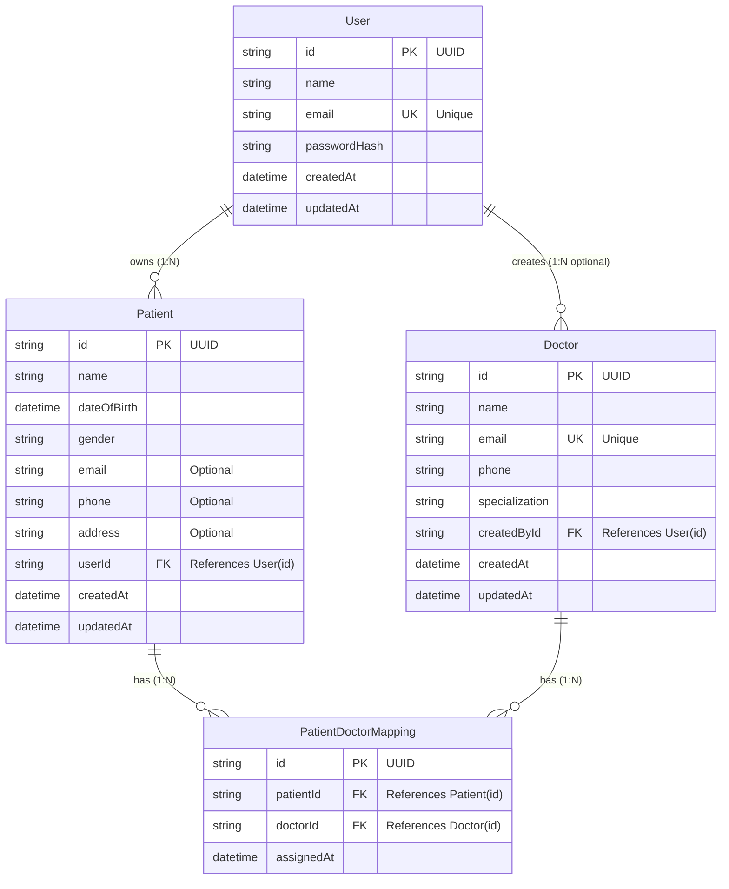

# Healthcare Backend REST API: Student Interview & Defense Guide

This guide is specifically prepared for campus-drive technical evaluations and system design interviews. It explains every design decision, code architecture flow, database relationship, and security control in beginner-friendly language so that you can explain and defend your implementation with confidence.

---

## Table of Contents

1. [Project Summary](#1-project-summary)
2. [Why Node.js & Express.js over Django](#2-why-nodejs--expressjs-over-django)
3. [Architecture: Express Request Lifecycle](#3-architecture-express-request-lifecycle)
4. [Roles & Responsibilities: Routes, Controllers, Services & Middleware](#4-roles--responsibilities-routes-controllers-services--middleware)
5. [Prisma ORM & PostgreSQL Database Design](#5-prisma-orm--postgresql-database-design)
6. [Why a Dedicated Mapping Table is Essential](#6-why-a-dedicated-mapping-table-is-essential)
7. [Authentication & JWT Mechanics](#7-authentication--jwt-mechanics)
8. [Password Hashing with Bcrypt](#8-password-hashing-with-bcrypt)
9. [Ownership & Multi-Tenant Authorization](#9-ownership--multi-tenant-authorization)
10. [Input Validation with Zod](#10-input-validation-with-zod)
11. [Centralized Error Handling](#11-centralized-error-handling)
12. [Database Constraints & Data Integrity](#12-database-constraints--data-integrity)
13. [Testing Strategy (Jest & Supertest)](#13-testing-strategy-jest--supertest)
14. [Security Posture & Production Limitations](#14-security-posture--production-limitations)
15. [How this Maps to Django REST Framework (DRF)](#15-how-this-maps-to-django-rest-framework-drf)
16. [End-to-End Request Walkthrough](#16-end-to-end-request-walkthrough)
17. [20+ Likely Campus Drive Questions & Model Answers](#17-20-likely-campus-drive-questions--model-answers)

---

## 1. Project Summary

The **Healthcare Backend REST API** is an enterprise-structured web service designed to manage healthcare providers, patients, and clinical consultations.
- **Patients**: Created and managed by authenticated users with strict ownership isolation (a user only sees and updates their own patients).
- **Doctors**: Registered healthcare professionals available for assignment across the facility.
- **Patient-Doctor Mappings**: A relational association joining a patient to an attending doctor, enforcing uniqueness and referential integrity.

---

## 2. Why Node.js & Express.js over Django

In the assignment brief:
> *"Framework: Please use the Django/Node framework for completing the assignment. You are free to use any libraries necessary."*

Even though specific Django packages were mentioned in later sub-clauses, Node.js was chosen because:
1. **Asynchronous Non-Blocking I/O**: Node.js utilizes an event-driven architecture that excels at high-throughput I/O-intensive operations (such as API gateways and database queries) with minimal memory footprint.
2. **Unified JavaScript/TypeScript Ecosystem**: Express.js allows building modern full-stack web applications using single-language tooling across both frontend and backend.
3. **Modular Control**: Unlike Django's "batteries-included" monolithic structure, Express provides complete architectural flexibility, allowing explicit modular separation of routes, controllers, and services.

---

## 3. Architecture: Express Request Lifecycle

Every incoming HTTP request traverses an explicit pipeline:



1. **Security Layer**: `helmet` sets secure HTTP headers (XSS protection, MIME sniffing protection); `cors` governs cross-origin access.
2. **Body Parser**: `express.json({ limit: '10kb' })` parses JSON payloads and enforces maximum payload sizes to prevent Denial-of-Service (DoS) buffer exhaustion.
3. **Authentication Middleware**: Verifies the `Authorization: Bearer <token>` header, decodes the JWT, checks database existence, and attaches `req.user`.
4. **Validation Middleware**: Executes Zod schemas against `req.body` or `req.params`, stopping bad requests before reaching business logic.
5. **Controller Layer**: Extracts request arguments, passes them to services, and formats the standard JSON response.
6. **Service Layer**: Implements business rules (ownership checks, conflict detection, password hashing) and executes ORM queries.
7. **Prisma ORM**: Converts high-level JavaScript calls into parameterized SQL queries executed on PostgreSQL.
8. **Centralized Error Handler**: Catches any thrown exceptions (`AppError`, `ZodError`, Prisma errors) and formats consistent HTTP responses.

---

## 4. Roles & Responsibilities: Routes, Controllers, Services & Middleware

| Layer | File Location | Single Responsibility | Interview Defense |
| :--- | :--- | :--- | :--- |
| **Routes** | `src/routes/*.routes.js` | Maps HTTP verbs (`GET`, `POST`, `PUT`, `DELETE`) and URLs to middleware and controllers. | Keeps routes declarative without mixing logic. |
| **Middleware** | `src/middleware/*.js` | Intercepts requests for authentication (`auth.middleware.js`), validation (`validate.middleware.js`), and error formatting (`error.middleware.js`). | Eliminates duplicate code across endpoints. |
| **Controllers** | `src/controllers/*.controller.js` | Handles HTTP-specific concerns: reading `req.params`, `req.body`, `req.user`, calling services, and returning `res.status().json()`. | Decouples business logic from the Express framework. |
| **Services** | `src/services/*.service.js` | Houses core domain rules, entity verification, access policies, password hashing, and database queries. | Can be unit-tested without needing mock HTTP request/response objects. |
| **Validators** | `src/validators/*.validator.js` | Declares strict input shapes, data types, string constraints, and UUID patterns via Zod. | Guarantees clean data enters the system. |

---

## 5. Prisma ORM & PostgreSQL Database Design

### Why Prisma ORM?
1. **Type Safety & Auto-completion**: Prisma generates a tailored client matching the database schema.
2. **SQL Injection Immunity**: All queries generated by Prisma are parameterized by default.
3. **Automated Migrations**: `prisma migrate dev` creates declarative, version-controlled SQL migration scripts (`migration.sql`).

### Entity Relationship Diagram (ERD)



---

## 6. Why a Dedicated Mapping Table is Essential

### Why NOT store an array of Doctor IDs inside the Patient document?
- **Relational Integrity**: In an array column (like PostgreSQL `text[]` or MongoDB arrays), foreign key constraints cannot be enforced on individual array elements. If a doctor is deleted, the array contains orphaned strings.
- **Many-to-Many Modeling**: A patient can consult multiple specialists (e.g., Cardiologist, Radiologist), and a doctor treats multiple patients. A junction table (`PatientDoctorMapping`) provides a 1-to-N relation from each side.
- **Metadata Storage**: The mapping table stores relationship-specific attributes such as `assignedAt`.
- **Composite Unique Constraints**: `@@unique([patientId, doctorId])` guarantees at the database engine level that duplicate assignments cannot occur, preventing race conditions.

---

## 7. Authentication & JWT Mechanics

1. **Client Registration**: User posts `name`, `email`, and `password`. The service normalizes the email to lowercase, hashes the password with 10 salt rounds of bcrypt, and saves the user.
2. **Client Login**: User posts `email` and `password`. If valid, a JSON Web Token (JWT) is signed with `HMAC-SHA256` using `JWT_SECRET`.
3. **Payload Structure**:
   ```json
   {
     "id": "user-uuid-here",
     "email": "user@example.com",
     "iat": 1740000000,
     "exp": 1740003600
   }
   ```
4. **Token Expiry**: Configured to `1h` to limit the window of vulnerability if a token is intercepted.
5. **No Passwords in Payload**: JWTs are base64-encoded strings, not encrypted. Sensitive information is strictly excluded.

---

## 8. Password Hashing with Bcrypt

### Plaintext vs. Hashes
- **Never Plaintext**: Plaintext storage means any database compromise immediately exposes user credentials.
- **Why not MD5 or SHA256?**: MD5 and standard SHA-256 are fast general-purpose hash functions. An attacker using GPUs can compute billions of guesses per second using precomputed rainbow tables.
- **Bcrypt Work Factor**: Bcrypt uses an adaptive key derivation function with an internal salt. With 10 salt rounds ($2^{10} = 1024$ iterations), it introduces deliberate computational cost that thwarts brute-force attacks while remaining unnoticeable to individual users.

---

## 9. Ownership & Multi-Tenant Authorization

### How is Patient Ownership Enforced?
1. **Never trust `req.body.userId`**:
   Clients can attempt mass-assignment attacks by supplying another user's UUID in the JSON body. In our implementation:
   ```javascript
   // src/services/patient.service.js
   const patient = await prisma.patient.create({
     data: {
       ...patientData,
       userId // Extracted directly from req.user.id verified by JWT
     }
   });
   ```
2. **Strict Query Scoping**:
   - `GET /api/patients/` executes `prisma.patient.findMany({ where: { userId } })`. It is physically impossible to view another user's patients.
   - `GET /api/patients/:id/`, `PUT`, and `DELETE` verify that `patient.userId === userId`. If not, a `404 Not Found` is returned.
3. **Why 404 instead of 403 for other users' patients?**:
   Returning `403 Forbidden` leaks information by revealing that the record exists. Returning `404 Not Found` completely conceals the resource existence from unauthorized users.

---

## 10. Input Validation with Zod

Every external input is validated against a Zod schema before controllers or services run:
- Validates field presence (`name is required`).
- Enforces lengths and formats (`email().toLowerCase()`).
- Coerces valid dates (`dateOfBirth` checked via `Date.parse`).
- Validates UUID syntax for route parameters (`:id` must be RFC 4122 UUID).

---

## 11. Centralized Error Handling

All errors bubble up to `src/middleware/error.middleware.js`:
- `ZodError` $\rightarrow$ `400 Bad Request` with an array of affected fields.
- `JsonWebTokenError` / `TokenExpiredError` $\rightarrow$ `401 Unauthorized`.
- Prisma `P2002` (Unique constraint) $\rightarrow$ `409 Conflict`.
- Prisma `P2025` (Record not found) $\rightarrow$ `404 Not Found`.
- Prisma `P2003` (Foreign key violation) $\rightarrow$ `409 Conflict`.
- Custom `AppError` $\rightarrow$ custom status code and message.
- Internal errors in production $\rightarrow$ `500 Internal server error` without leaking stack traces.

---

## 12. Database Constraints & Data Integrity

1. **`users.email`**: `@unique` index prevents duplicate user accounts.
2. **`doctors.email`**: `@unique` index prevents duplicate doctor registrations.
3. **`patient_doctor_mappings(patientId, doctorId)`**: `@@unique` prevents duplicate assignments.
4. **Foreign Key Cascade Policy**:
   - `Patient.userId` $\rightarrow$ `User.id` `ON DELETE CASCADE`: If a user deletes their account, their patient records are removed.
   - `PatientDoctorMapping.patientId` $\rightarrow$ `Patient.id` `ON DELETE CASCADE`: Deleting a patient cleans up their doctor assignments automatically.
   - `PatientDoctorMapping.doctorId` $\rightarrow$ `Doctor.id` `ON DELETE RESTRICT`: Prevents accidental deletion of doctors who have active patient consultations.

---

## 13. Testing Strategy (Jest & Supertest)

- Automated tests execute real HTTP calls using `supertest` against the Express application.
- Uses actual PostgreSQL queries to ensure SQL constraints, triggers, and migrations function as expected.
- **Repeatable Cleanup**: `tests/helpers/testDb.js` cleans tables before every test in proper foreign key order (`mappings` $\rightarrow$ `patients` $\rightarrow$ `doctors` $\rightarrow$ `users`).

---

## 14. Security Posture & Production Limitations

### Educational vs. Production Healthcare Backend:
1. **HIPAA / GDPR Compliance**: Production healthcare systems require formal encryption at rest (AES-256), field-level encryption for Protected Health Information (PHI), audit logging of every read access, and Business Associate Agreements (BAA).
2. **Token Invalidation**: Production systems utilize Redis-backed token revocation lists or short-lived access tokens with rotating refresh tokens stored in `httpOnly` secure cookies.
3. **Rate Limiting**: Production APIs require `express-rate-limit` to prevent brute-force attacks on `/api/auth/login/`.

---

## 15. How this Maps to Django REST Framework (DRF)

If asked by an evaluator: *"The prompt mentioned Django. How does your Node.js architecture compare to Django?"*

| Concept | Django REST Framework (DRF) | Node.js / Express Implementation (Our Code) |
| :--- | :--- | :--- |
| **Routing** | `urls.py` (`DefaultRouter`) | `src/routes/*.routes.js` (`express.Router()`) |
| **Input Validation** | `serializers.Serializer` / `ModelSerializer` | `src/validators/*.validator.js` (`zod`) |
| **Authentication** | `djangorestframework-simplejwt` | `jsonwebtoken` + `auth.middleware.js` |
| **Password Hashing** | `django.contrib.auth.hashers` (PBKDF2) | `bcryptjs` (Bcrypt, 10 rounds) |
| **Database ORM** | Django ORM (`models.Model`) | Prisma ORM (`prisma/schema.prisma`) |
| **Permissions** | `permissions.IsAuthenticated`, `BasePermission` | `auth.middleware.js`, `patient.service.js` |
| **Migrations** | `python manage.py makemigrations / migrate` | `npx prisma migrate dev` |

---

## 16. End-to-End Request Walkthrough

Let's trace a complete lifecycle: **User registers $\rightarrow$ logs in $\rightarrow$ creates patient $\rightarrow$ creates doctor $\rightarrow$ assigns doctor $\rightarrow$ retrieves doctors $\rightarrow$ deletes assignment**.

### Step 1: User Registration
- **Request**: `POST /api/auth/register/` with `name`, `email`, `password`.
- **Files**: `src/routes/auth.routes.js` $\rightarrow$ `src/validators/auth.validator.js` $\rightarrow$ `src/controllers/auth.controller.js` $\rightarrow$ `src/services/auth.service.js`.
- **DB Impact**: Row inserted into `users` table with bcrypt `passwordHash`.
- **Response**: `201 Created` with sanitized user object.

### Step 2: User Login
- **Request**: `POST /api/auth/login/` with `email`, `password`.
- **Files**: `auth.controller.js` $\rightarrow$ `auth.service.js` verifies password with `bcrypt.compare`.
- **Response**: `200 OK` with signed JWT token.

### Step 3: Create Patient
- **Request**: `POST /api/patients/` with `Authorization: Bearer <token>` and patient fields.
- **Files**: `auth.middleware.js` extracts `req.user.id` $\rightarrow$ `patient.validator.js` validates data $\rightarrow$ `patient.service.js` forces `userId = req.user.id`.
- **DB Impact**: Row inserted into `patients` table with foreign key `userId`.
- **Response**: `201 Created`.

### Step 4: Create Doctor
- **Request**: `POST /api/doctors/` with `Authorization: Bearer <token>` and doctor details.
- **Files**: `doctor.validator.js` $\rightarrow$ `doctor.controller.js` $\rightarrow$ `doctor.service.js` checks duplicate email.
- **DB Impact**: Row inserted into `doctors` table with `createdById = req.user.id`.
- **Response**: `201 Created`.

### Step 5: Assign Doctor to Patient
- **Request**: `POST /api/mappings/` with `{"patientId": "...", "doctorId": "..."}`.
- **Files**: `mapping.service.js` verifies patient belongs to `req.user.id`, verifies doctor exists, checks duplicate mapping.
- **DB Impact**: Row inserted into `patient_doctor_mappings` with foreign keys to both tables.
- **Response**: `201 Created`.

### Step 6: Retrieve Assigned Doctors
- **Request**: `GET /api/mappings/:patient_id/`.
- **Files**: `mapping.service.js` verifies `patient.userId === req.user.id` $\rightarrow$ queries mappings joining doctor details.
- **Response**: `200 OK` with patient details and array of assigned doctor profiles.

### Step 7: Delete Mapping
- **Request**: `DELETE /api/mappings/:id/`.
- **Files**: `mapping.service.js` verifies mapping exists and patient belongs to `req.user.id`.
- **DB Impact**: Deletes row from `patient_doctor_mappings`. Neither `patients` nor `doctors` table is modified.
- **Response**: `200 OK`.

---

## 17. 20+ Likely Campus Drive Questions & Model Answers

### Q1: Why did you use ES Modules (`import/export`) instead of CommonJS (`require`)?
**Answer**: ES Modules are the official ECMAScript standard for JavaScript. They enable static module analysis, tree-shaking, and consistency with modern frontend frameworks like React. We configured `"type": "module"` in `package.json`.

### Q2: How do you prevent a malicious user from viewing another patient's medical records?
**Answer**: Through ownership-scoped queries and JWT verification. We never trust client-supplied user IDs. In `patient.service.js`, we filter all queries by `where: { userId: req.user.id }`. If a user accesses `/api/patients/:id` for an ID that does not belong to them, we return `404 Not Found`.

### Q3: Why return 404 instead of 403 when a user accesses someone else's patient?
**Answer**: To prevent resource enumeration. If we return `403 Forbidden`, the attacker knows that the ID exists in the system. Returning `404 Not Found` conceals whether the resource exists at all.

### Q4: What prevents the same doctor from being assigned to the same patient twice?
**Answer**: Dual-layer protection:
1. **Application layer**: `mapping.service.js` checks `prisma.patientDoctorMapping.findUnique` before creation and returns `409 Conflict`.
2. **Database layer**: A composite unique constraint `@@unique([patientId, doctorId])` in PostgreSQL guarantees that even concurrent requests cannot create duplicates.

### Q5: How do you handle password storage securely?
**Answer**: We use `bcryptjs` with 10 salt rounds. Bcrypt automatically generates a cryptographic salt and hashes the password using the Blowfish cipher. We never log passwords or return password hashes in API responses.

### Q6: What does the JWT payload contain and why?
**Answer**: The payload only contains `{ id, email }`. It does not contain passwords, personal health information, or confidential data, because JWTs are base64-encoded and can be decoded by anyone with access to the token.

### Q7: What is the purpose of `helmet` and `cors`?
**Answer**:
- `helmet` secures Express apps by setting various HTTP headers (Content Security Policy, X-Frame-Options against clickjacking, Strict-Transport-Security).
- `cors` controls Cross-Origin Resource Sharing, restricting or allowing which domains can query the backend from a browser.

### Q8: How does your centralized error handler distinguish between validation errors and database errors?
**Answer**: In `error.middleware.js`, we check `if (err instanceof ZodError)` to format request validation errors into a clean field-by-field array, and `if (err instanceof Prisma.PrismaClientKnownRequestError)` to map database error codes (like `P2002` for unique constraints) into appropriate HTTP status codes (`409 Conflict`).

### Q9: What happens if a client sends invalid JSON syntax?
**Answer**: The body parser middleware catches the syntax error and forwards it to `error.middleware.js`, which identifies `SyntaxError` and returns `400 Bad Request` with `{"success": false, "message": "Invalid JSON payload received"}` rather than crashing the server.

### Q10: Why did you use Prisma instead of raw SQL queries?
**Answer**: Prisma generates parameterized SQL queries that protect against SQL injection, provides TypeScript/JavaScript type-safety, and manages version-controlled migrations through `prisma migrate dev`.

### Q11: What is the deletion policy if someone tries to delete a doctor who is currently mapped to patients?
**Answer**: The foreign key in `schema.prisma` is configured with `onDelete: Restrict`. Furthermore, `doctor.service.js` proactively checks `prisma.patientDoctorMapping.count({ where: { doctorId } })` and returns a `409 Conflict` informing the user that active mappings must be removed first, protecting referential integrity.

### Q12: What happens if a patient record is deleted? Does it leave orphaned mappings?
**Answer**: No. `PatientDoctorMapping.patientId` is configured with `onDelete: Cascade`. When a patient is deleted, all their associated mapping records are automatically cleaned up by PostgreSQL.

### Q13: What does `prisma generate` do?
**Answer**: `prisma generate` reads `schema.prisma` and generates a customized `@prisma/client` library in `node_modules` tailored to our exact models, relations, and fields.

### Q14: How do you handle environment variables safely?
**Answer**: We use `dotenv` with a validated Zod schema in `src/config/env.js`. If any required variable (`DATABASE_URL`, `JWT_SECRET`) is missing at startup, the application logs the missing fields and exits immediately. `.env` is excluded in `.gitignore`, and `.env.example` provides safe placeholders.

### Q15: How does your test suite prevent corrupting the development database?
**Answer**: Tests run against an isolated test environment and utilize `tests/helpers/testDb.js` to clean tables before each test execution.

### Q16: Why did you choose Zod over alternatives like Joi or express-validator?
**Answer**: Zod provides declarative, composable schema validation with zero dependencies, excellent type inference, and flexible custom refinements (`refine`).

### Q17: What is the difference between `PUT` and `PATCH`?
**Answer**: `PUT` traditionally replaces a resource or updates all supplied fields, while `PATCH` applies partial modifications. In our implementation, `PUT` supports partial updates while requiring at least one valid field.

### Q18: What is a race condition in database operations and how do you mitigate it?
**Answer**: A race condition occurs when concurrent asynchronous requests check and insert data simultaneously (e.g., two requests checking if a doctor assignment exists). Application checks alone can fail if both requests read before either writes. Our database composite unique constraint `@@unique([patientId, doctorId])` guarantees atomic serialization at the database engine level.

### Q19: If an evaluator asks why you did not use Django, how do you answer?
**Answer**:
*"The assignment brief began with 'Framework: Please use the Django/Node framework for completing the assignment. You are free to use any libraries necessary.' I chose Node.js with Express and Prisma because I have deep proficiency in JavaScript and the event-driven non-blocking I/O model. I have fully documented the technology translation in the README and INTERVIEW_GUIDE, mapping Express to Django views, Zod to DRF Serializers, Prisma to Django ORM, and jsonwebtoken to SimpleJWT."*

### Q20: What are 3 improvements you would add before releasing this to real hospitals?
**Answer**:
1. **HIPAA-compliant Field Encryption**: Encrypting patient identifiable information (PHI) at rest using AES-256.
2. **Refresh Token Rotation & Revocation**: Short-lived access tokens (15 mins) with refresh tokens stored in secure, `httpOnly` cookies.
3. **Audit Trail Logging**: Dedicated audit logging table recording every access or modification of patient records with timestamp and actor ID.
